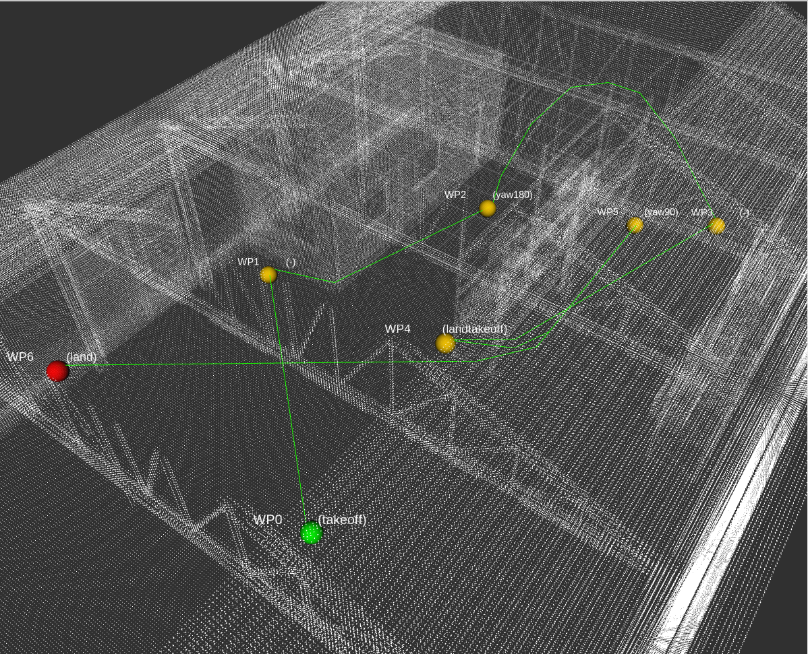
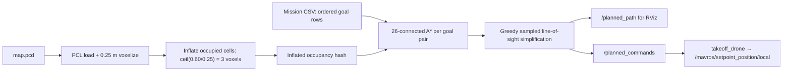
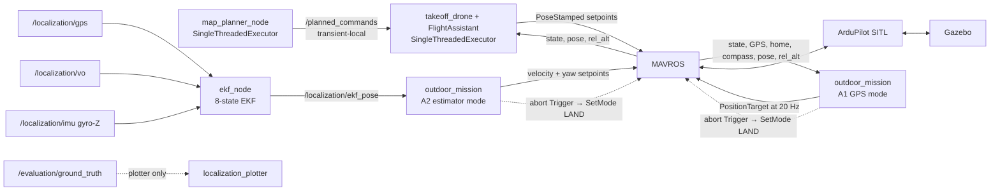

# My Drone Control — A1 Mapping and A2 Localization

A ROS 2 package for 3D PCD map processing, voxel grid downsampling, 3D obstacle inflation, spatial occupancy querying, mission CSV waypoint parsing, 3D A* path planning, and line-of-sight path post-processing for autonomous drone navigation in hangar environments.

## Contents

- [A1 — Mapping and missions](#a1-mapping-and-missions)
  - [A1.1 — Map processing and path planning](#a1-1-map-processing)
  - [A1.2 — Mission execution, indoor flight](#a1-2-mission-execution)
  - [A1.3 — Outdoor GPS mission](#a1-3-outdoor-mission)
- [A2 — Localization and EKF flight](#a2-localization-and-ekf-flight)
  - [A2.1 — Localization plots and sensor controls](#assignment-2-localization-plots)
  - [A2.2 — Eight-state Extended Kalman Filter (EKF)](#assignment-2-2-ekf)
- [Prerequisites and build](#prerequisites-and-build)
- [Start A1 and A2](#start-a1-and-a2)
- [How to run](#how-to-run)
- [ROS 2 interface](#ros-2-interface)
- [Solution diagrams](#solution-diagrams)

---

<a id="a1-mapping-and-missions"></a>
## A1 — Mapping and missions

<a id="a1-1-map-processing"></a>
### A1.1 — Map processing and path planning

### 1. Map representation

PCL loads `maps/map.pcd` and downsamples it into a **0.25 m uniform voxel grid**. Occupied cells are stored in a hash set for constant-average-time collision queries. This resolution preserves hangar-scale features and keeps neighbour checks simple. An octree could save memory in empty regions, but adds variable-resolution query complexity; the uniform grid uses more memory and loses features smaller than one cell. The filtered map contains 16,482 occupied voxels.

### 2. Obstacle inflation

The configured `safety_radius` is **0.60 m**, estimated from 0.33 m vehicle radius, 0.15 m controller error, and 0.12 m margin. The implementation rounds `ceil(0.60 / 0.25)` up to **3 voxels**, then inflates cells satisfying `dx² + dy² + dz² <= 3²`. Thus the effective radius between voxel centres is **0.75 m**. This errs on the side of clearance but may close narrow gaps. Shelves are blocked only where they appear in the PCD; sparse map points can leave false-clear areas.

### 3. 3D A* planning

The planner uses 26-connected A* on the inflated grid, with Euclidean edge costs and an admissible Euclidean heuristic. If the search completes, it gives a lowest-cost path on the discrete voxel graph. Compared with RRT, it is deterministic and directly uses the occupancy grid; its costs are memory/runtime growth with explored cells and no continuous-space optimality. Diagonal transitions check the destination voxel only, so corner-cutting near obstacles is a known limitation.

The CSV (`x,y,z,precision,task`) contains ordered goal waypoints, not a path. A separate search connects each consecutive pair. Occupied endpoints or an exhausted search stop planning.

### 4. Path simplification

Greedy line-of-sight shortcutting replaces a path section with the furthest later voxel visible through the inflated grid. The example reduced **172 points to 24 (86%)** in about **2.56 s** on this machine. Segments are checked using rounded samples, which is fast but not exact voxel traversal; a collision between samples can be missed, so this is not a formal continuous collision guarantee.



[Back to Contents](#contents)

<a id="a1-2-mission-execution"></a>
### A1.2 — Mission execution, indoor flight

The planner publishes `/planned_commands`; `takeoff_drone` controls MAVROS. A mission file can be selected at runtime with `-p mission_path:=/path/to/file.csv`. The controller runs at 10 Hz and `FlightAssistant` sends position setpoints at 20 Hz.

#### Position and precision

Map positions are converted to local targets using `local_x = -map_y`, `local_y = map_x`, `local_z = map_z`.

| Precision | Position radius | Yaw tolerance |
| --- | ---: | ---: |
| `soft` | 0.30 m | 10° |
| `hard` | 0.15 m | 5° |

The tighter hard radius is intended for accurate task goals; the looser soft radius allows more transit tolerance. **Known limits:** arrival is a single position/yaw sample, without a settling period or velocity check. Intermediate planned points are also processed in order and can inherit hard precision, so they may cause stops instead of passing through.

#### Tasks and heading

`takeoff` uses the first takeoff row's Z (or the `target_altitude` parameter) and monitors relative altitude. `land` lowers the local Z target and exits near ground level; it does not request LAND mode or confirm disarming. `landtakeoff` descends and climbs again but does not re-arm or restore GUIDED after touchdown.

Yaw setpoints use ROS ENU: zero is East and positive is counter-clockwise. `yaw<degrees>` adds to an internal target that starts at zero, rather than the measured aircraft heading. The controller does not calculate the next segment bearing or unwrap to the shortest turn, so forward-facing travel and reliable absolute/relative yaw tasks remain incomplete. MAVROS converts ENU targets to the FCU's NED convention.

[Back to Contents](#contents)

<a id="a1-3-outdoor-mission"></a>
### A1.3 — Outdoor GPS mission

The outdoor mission is relative to the captured home/origin: **takeoff → square → POI transit → figure-8 → return → land**. Parameters keep the required 5 m altitude, 5 m square, and 3 m amplitude. The default `figure_eight_omega = 0.25 rad/s` gives peak speed `Aω√2 ≈ 1.06 m/s` and lap time `2π/ω ≈ 25.1 s`.

#### GPS, coordinates, compass, and altitude

The node waits for a fresh valid GPS fix and at least six satellites before requesting mode or arming. It prefers MAVROS home, falling back to the first usable fix after five seconds. Planning offsets are local ENU, not fixed absolute coordinates. Geodetic-to-ENU and inverse conversions use a flat-Earth tangent approximation with the equatorial radius. Over 50 m, curvature contributes under 1 mm; the radius approximation contributes about 0.2% scale error (about 0.1 m), before GPS error.

GPS altitude is AMSL; `/mavros/global_position/rel_alt` is above home; setpoint Z is local ENU up. The mission requests 5 m takeoff and checks relative altitude. Compass is magnetic degrees clockwise from North; pose/setpoint yaw is ENU degrees counter-clockwise from East, with `yaw_ENU = wrap(90° - heading)`. The node logs both conventions for comparison; empirical agreement while rotating in SITL still needs validation. Yaw aims horizontally at the POI; no camera pitch is commanded.

#### Square, trajectory, and return

At 20 Hz, the node recomputes bearing to a parameterized POI while following the four 5 m square edges. It then transits to the POI before starting the timer-driven figure-8:

$$x=x_{POI}+A\sin(t),\quad y=y_{POI}+A\sin(t)\cos(t),\quad t=\omega(now-t_{start})$$

For default offsets (2.5 m East, -2.5 m North), the square's far corner is 7.07 m from launch; the farthest figure-8 point is about 6.37 m from launch. The square therefore sets the 7.07 m horizontal bound. Add launch-to-home offset when checking the home-centred geofence; the node does not enforce a geofence. Tangent yaw is commanded with each setpoint and unwrapped between updates. Smooth tracking and completion have not yet been evidenced by a full SITL run.

After one lap it returns to launch and requests LAND. `/outdoor_mission/abort` also requests LAND. If FCU/GPS/pose freshness or GUIDED mode is lost in flight, it stops publishing mission setpoints. Demonstrate abort and full mission in SITL before any real flight; an instructor and safety pilot are required.

```bash
ros2 service call /outdoor_mission/abort std_srvs/srv/Trigger "{}"
```

[Back to Contents](#contents)

<a id="a2-localization-and-ekf-flight"></a>
## A2 — Localization and EKF flight

<a id="assignment-2-localization-plots"></a>
### A2.1 — Localization plots and sensor controls

The localization plot tool is separate from the estimator and controllers. It
subscribes to GPS, VO, IMU, and evaluation ground truth for visualization only;
it does not publish control or estimator feedback. Its terminal report includes
simulation-stamp and wall-clock rates, frame IDs, sensor freshness transitions,
GPS/VO position residuals against truth, and a rolling gyro-Z mean and standard
deviation. The live plots show the XY track, ENU X/Y/Z, VO/truth yaw, and gyro Z
alongside the truth yaw rate. A 120-second sliding window covers startup,
the complete square, and landing. Plot x-axes use sensor simulation time;
the plotter detects and corrects backward clock resets so the run remains
continuous. The plot title shows elapsed simulation time and whether each
stream is live; stream-health checks use wall time so a paused Gazebo clock
does not freeze the terminal diagnostics.

Build the workspace package and the supplied sensor simulator package. The
sensor package is in the separate `LRS-URK` checkout:

```bash
cd ~/ros2_ws
source /opt/ros/jazzy/setup.bash
colcon build --base-paths src "$HOME/LRS-URK/localization_sensor_sim" \
  --packages-select my_drone_control localization_sensor_sim
source install/setup.bash
```

Start the full sensor/vehicle stack and plots with one launch command:

```bash
ros2 launch my_drone_control localization_plots.launch.py \
  repo_dir:="$HOME/LRS-URK" seed:=42
```

The launch starts the seeded Gazebo world, SITL, MAVROS, sensor bridge and
corruption node, and the plotter. It does **not** start a mission or arm the
drone. Press Ctrl+C in the launch terminal to stop all processes. Use the same
seed for Gazebo and the sensor simulator; change `repo_dir` if the LRS-URK
checkout is elsewhere. The plotter compares the VO track with truth as
published; VO is in `vo_odom`, so treat its residual as an alignment/drift
diagnostic, not as a substitute for a frame transform in the estimator.

To move the simulated drone through one small square while collecting plots,
explicitly enable the optional setpoint-only mission:

```bash
ros2 launch my_drone_control localization_plots.launch.py \
  repo_dir:="$HOME/LRS-URK" seed:=42 run_square:=true
```

The plotter starts with the launch, before Gazebo and the mission, so it can
capture the whole flight regardless of SITL startup duration or simulation
speed.

This arms SITL, requests takeoff to 1.5 m through `/mavros/cmd/takeoff`, then
commands one 2 m square at a nominal 0.5 m/s from the localization world's
initial ENU position `(-7, 13)`, returns to that start setpoint, and requests
LAND. It uses the same `/mavros/setpoint_position/local` `PoseStamped`
interface as the working Assignment 1 controller. `/mavros/state` is used
only for connection/mode/arming status; the mission does not use MAVROS pose
feedback, GPS, or ground truth. This setpoint-only mission is for sensor
characterization in the supplied SITL world, not the final Assignment 2
controller. Verify the Gazebo scene and keep a safety pilot ready before
enabling it. Set `run_square:=false` (the default) for stationary
characterization. The mission does not publish position setpoints until the
takeoff command has been accepted and its 12-second hold has elapsed. If SITL
disarms during that interval, the mission stops and logs an error instead of
continuing the square; command acceptance alone is not treated as proof of
climb. After MAVROS connects, it waits 20 seconds for SITL/EKF startup before
requesting GUIDED and arming. Expect roughly 80 seconds from launch through
landing. Leave the launch running until it logs `Vehicle disarmed; square
mission complete`; Ctrl+C during a leg stops the mission before its LAND phase.
Gazebo and SITL build output are routed to ROS launch log files to keep the
terminal focused on MAVROS status, sensor readiness, and mission progress.

[Back to Contents](#contents)

---

<a id="assignment-2-2-ekf"></a>
### A2.2 — Eight-state Extended Kalman Filter (EKF)

The custom EKF runs in `ekf_node.py`. It predicts from the simulated IMU's yaw-rate Z, corrects ENU position from GPS, and corrects yaw and velocity from VO. It does not use MAVROS pose feedback, IMU orientation, accelerometer data, or ground truth. The controller consumes the published estimate, so this is a closed-loop localization flight rather than an EKF display beside the original GPS-feedback mission.

### 1. State vector and frame conventions

The filter estimates the mandatory 8-state vector in the world ENU `map` frame:

$$\mathbf{x} = [x, y, z, v_x, v_y, v_z, \psi, b]^T$$

- Position: $\mathbf{p} = [x, y, z]^T$ in meters (`map` frame).
- Velocity: $\mathbf{v} = [v_x, v_y, v_z]^T$ in m/s (`map` frame).
- Yaw: $\psi$ in radians, counter-clockwise from East, wrapped strictly to $[-\pi, \pi)$.
- Gyro bias: $b$ in rad/s, representing the IMU angular rate Z bias.

Published outputs:
- **Topic**: `/localization/ekf` as `nav_msgs/msg/Odometry` (`frame_id='map'`, `child_frame_id='base_link'`).
- **Pose topic**: `/localization/ekf_pose` as `geometry_msgs/msg/PoseStamped` (`frame_id='map'`).
- **Covariance**: Full 6×6 pose covariance ($x, y, z, \text{roll}, \text{pitch}, \text{yaw}$) and twist covariance ($v_x, v_y, v_z$).
- **Controller consumption**: `outdoor_mission` with `use_estimator:=true` uses `/localization/ekf_pose` as its only position/yaw feedback (see §8).

### 2. Prediction model (IMU-driven constant velocity)

On every IMU message (100 Hz), the elapsed time $\Delta t$ is computed from message header stamps. The state propagates forward via:

$$\begin{aligned}
\mathbf{p}_k &= \mathbf{p}_{k-1} + \mathbf{v}_{k-1} \Delta t \\
\mathbf{v}_k &= \mathbf{v}_{k-1} + \mathbf{w}_v \\
\psi_k &= \text{wrap}\left(\psi_{k-1} + (\omega_{z, \text{meas}} - b_{k-1}) \Delta t\right) \\
b_k &= b_{k-1} + w_b
\end{aligned}$$

The state transition Jacobian $\mathbf{F} = \frac{\partial \mathbf{f}}{\partial \mathbf{x}}$ is an $8 \times 8$ identity matrix with the following off-diagonal elements:
- $\mathbf{F}_{0,3} = \mathbf{F}_{1,4} = \mathbf{F}_{2,5} = \Delta t$ (position derivative w.r.t velocity)
- $\mathbf{F}_{6,7} = -\Delta t$ (yaw derivative w.r.t gyro bias: $\frac{\partial \psi_k}{\partial b_{k-1}} = -\Delta t$)

Covariance prediction:
$$\mathbf{P}_k = \mathbf{F} \mathbf{P}_{k-1} \mathbf{F}^T + \mathbf{Q} \Delta t$$

where $\mathbf{Q} = \text{diag}(q_{\text{pos}}, q_{\text{pos}}, q_{\text{pos}}, q_{\text{vel}}, q_{\text{vel}}, q_{\text{vel}}, q_{\text{yaw}}, q_{\text{bias}})$.

### 3. Asynchronous measurement updates

Measurement updates are applied strictly asynchronously as sensor messages arrive, without waiting for time synchronisation across sensors. Duplicate and out-of-order timestamps ($t \le t_{\text{last}}$) and simulation clock jumps ($t < t_{\text{last}} - 0.5$) are rejected or handled gracefully.

1. **GPS position correction (5 Hz)**:
   - Measures absolute position $\mathbf{z}_{\text{gps}} = [x_{\text{gps}}, y_{\text{gps}}, z_{\text{gps}}]^T$ in `map` frame.
   - Measurement matrix $\mathbf{H}_{\text{gps}}$ selects state indices 0, 1, 2.
   - GPS position noise is zero-mean white noise with $\sigma = [0.6, 0.6, 0.9]\,\text{m}$. Fusing GPS eliminates long-term drift.
   - Measurement covariance $\mathbf{R}_{\text{gps}}$ is loaded dynamically from the message covariance array.

2. **VO yaw correction (30 Hz)**:
   - Measures heading $\psi_{\text{vo}}$.
   - Measurement matrix $\mathbf{H}_{\text{yaw}} = [0, 0, 0, 0, 0, 0, 1, 0]$.
   - Innovation is explicitly wrapped: $\tilde{y} = \text{wrap}(\psi_{\text{vo}} - \hat{\psi})$.

3. **VO body velocity correction (30 Hz, Nonlinear EKF)**:
   - VO provides linear velocity in the body frame: $\mathbf{z}_{\text{vel}} = [v_{b,x}, v_{b,y}, v_{b,z}]^T$.
   - The genuine nonlinear measurement model maps world velocity and estimated yaw to body frame:
     $$h(\mathbf{x}) = \mathbf{R}(\psi)^T \mathbf{v}_{\text{world}} = \begin{bmatrix} \cos(\psi) v_x + \sin(\psi) v_y \\ -\sin(\psi) v_x + \cos(\psi) v_y \\ v_z \end{bmatrix}$$
   - Analytical measurement Jacobian $\mathbf{H}_{\text{vel}} = \frac{\partial h}{\partial \mathbf{x}}$ ($3 \times 8$ matrix):
     $$\mathbf{H}_{\text{vel}} = \begin{bmatrix}
     0 & 0 & 0 & \cos\psi & \sin\psi & 0 & -\sin(\psi) v_x + \cos(\psi) v_y & 0 \\
     0 & 0 & 0 & -\sin\psi & \cos\psi & 0 & -\cos(\psi) v_x - \sin(\psi) v_y & 0 \\
     0 & 0 & 0 & 0 & 0 & 1 & 0 & 0
     \end{bmatrix}$$
   - Fusing body velocity provides high-rate velocity damping and dead-reckoning during GPS noise or outages without inheriting VO position drift.

### 4. Gyro bias observability

The gyro bias $b$ is not directly measured by any sensor, but becomes fully observable through the coupling between yaw prediction and VO yaw measurement updates:

1. In the prediction step, $\mathbf{F}_{6,7} = -\Delta t$. Propagating $\mathbf{P} \leftarrow \mathbf{F} \mathbf{P} \mathbf{F}^T$ develops an off-diagonal cross-covariance between yaw and bias:
   $$\mathbf{P}_{\psi, b} \approx \mathbf{P}_{\psi, b}^{\text{prior}} - \Delta t \cdot \mathbf{P}_{b, b}$$
   Because the bias variance $\mathbf{P}_{b, b} > 0$, a non-zero correlation builds up whenever gyro measurements are integrated.
2. When a VO yaw measurement arrives ($\mathbf{H}_{\text{yaw}} = [0, 0, 0, 0, 0, 0, 1, 0]$), the Kalman gain component for gyro bias is:
   $$\mathbf{K}_b = \frac{\mathbf{P}_{b, \psi}}{\mathbf{P}_{\psi, \psi} + R_{\text{yaw}}}$$
3. Because $\mathbf{P}_{b, \psi} \neq 0$, any persistent residual between the integrated gyro yaw and VO yaw directly drives the gyro bias correction:
   $$\hat{b} \leftarrow \hat{b} + \mathbf{K}_b \cdot \text{wrap}(\psi_{\text{vo}} - \hat{\psi})$$
   This makes the unknown gyro bias observable and continually estimated.

### 5. Deliberate initialization

The filter initializes when the first GPS position arrives:
- $\hat{\mathbf{p}}_0 = \mathbf{p}_{\text{first GPS}}$ and $\hat{\mathbf{v}}_0 = [0, 0, 0]^T$.
- If a VO yaw has already arrived, it seeds $\hat{\psi}_0$; otherwise yaw starts at zero and the next VO yaw corrects it.
- Initial variances are GPS-derived for position, $1.0\,\text{m}^2/\text{s}^2$ for velocity, $(\pi/4)^2\,\text{rad}^2$ for yaw, and $(0.1)^2\,(\text{rad/s})^2$ for gyro bias.
- VO position is recorded during startup but is not fused. Ground truth (`/evaluation/ground_truth`) is never subscribed to by the estimator.

### 6. Plotter integration

The `localization_plotter.py` node:
- Subscribes to `/localization/ekf` (`Odometry`).
- Computes and renders the dynamic **2-$\sigma$ horizontal covariance ellipse** centered on the estimated $(x, y)$ position on the **Horizontal track** subplot.
- Overlays the EKF state tracks in red across **all 6 subplots** (Horizontal track, X, Y, Altitude, Yaw, and Yaw rate).
- Displays EKF stream health, sim-time progress, and RMS position error vs ground truth in the live diagnostics summary.

### 7. Missing and bad measurements (Assignment 2.3)

- **GPS outlier gate**: before each GPS update the normalised innovation squared
  $d^2 = \mathbf{r}^T \mathbf{S}^{-1} \mathbf{r}$, with $\mathbf{S} = \mathbf{H}\mathbf{P}\mathbf{H}^T + \mathbf{R}$,
  is compared with `gps_gate_chi2` (default 11.34, the 99 % quantile of $\chi^2_3$). Because the
  gate uses $\mathbf{S}$, it widens automatically after an outage, when $\mathbf{P}$ has grown.
  Rejections are logged with their NIS value. After `gps_max_consecutive_rejects` (default 10)
  consecutive rejections the sample is accepted, so a diverged estimate cannot lock GPS out forever.
- **Outages**: the filter keeps predicting on IMU and fusing whichever sensors remain. It never
  resets. A 10 Hz watchdog logs a single `TIMEOUT` / `RECOVERED` transition per sensor
  (`gps_timeout_s` = 1.0, `vo_timeout_s` = 0.5, `imu_timeout_s` = 0.2), never at sensor rate.
- Duplicate or out-of-order stamps ($t \le t_{\text{last}}$) are dropped. The Kalman gain is
  computed with `np.linalg.solve` rather than an explicit inverse.
- **Manual tests**: in the terminal running `2lrs.sh` (see §9), press `e` to disable GPS and `e`
  again to re-enable it (`/localization/set_gps_enabled`), or `o` to inject one GPS outlier
  (`/localization/inject_gps_outlier`).

### 8. Flight using estimated localisation (Assignment 2.4)

`outdoor_mission` (the A1.3 square + figure-8) has a `use_estimator` mode. When it is on:

- Pose feedback comes from `/localization/ekf_pose` (`map`, ENU). The node does not subscribe to
  any `/mavros/local_position/*` or `/mavros/global_position/*` topic (GPS fix, home, compass and
  `rel_alt` are all disabled).
- The first EKF pose is the mission origin. Relative altitude is the estimated $z$ minus that first $z$.
- Each setpoint becomes a velocity command,
  $\mathbf{v} = \text{clamp}(k_p(\mathbf{p}_{\text{target}} - \hat{\mathbf{p}}), \pm v_{\max})$
  (`velocity_gain` = 0.8, `max_velocity` = 1.0), plus an absolute ENU yaw on
  `/mavros/setpoint_raw/local`. This means the loop is closed on the estimate, not on ArduPilot's own position.
- MAVROS is used only for state, mode, arming, takeoff and LAND.

```bash
ros2 launch my_drone_control localization_plots.launch.py \
  repo_dir:="$HOME/LRS-URK" seed:=42 run_mission:=true
```

Mission parameters for this run: 2 m altitude, 4 m square at 0.5 m/s, then one figure-8
(A = 2 m, ω = 0.2 rad/s) centred at (+2, −2) m from the origin, return and LAND.

### 9. Starting A2 and manual sensor tests

Build and source the workspace as described below, then start the estimator, sensors, plots, and estimator-driven square plus figure-8 mission:

```bash
cd ~/ros2_ws
source /opt/ros/jazzy/setup.bash
source install/setup.bash
ros2 launch my_drone_control localization_plots.launch.py \
  repo_dir:="$HOME/LRS-URK" seed:=42 run_mission:=true
```

The launch starts the seeded localization world, SITL, MAVROS, sensor simulation, EKF, plotter, and `outdoor_mission` in estimator mode. It also opens a GPS-control terminal:

| Key | Action |
|---|---|
| `e` | Toggle GPS off/on in the GPS-control terminal |
| `q` | Close the GPS-control terminal; the simulation keeps running |

To inject a one-shot GPS outlier or test another sensor outage, call the simulator service from a sourced terminal:

```bash
ros2 service call /localization/inject_gps_outlier std_srvs/srv/Trigger "{}"
ros2 service call /localization/set_gps_enabled std_srvs/srv/SetBool "{data: false}"
ros2 service call /localization/set_gps_enabled std_srvs/srv/SetBool "{data: true}"
ros2 service call /localization/set_vo_enabled std_srvs/srv/SetBool "{data: false}"
ros2 service call /localization/set_vo_enabled std_srvs/srv/SetBool "{data: true}"
```

Use the keyboard toggle or service calls for manual characterization only. The assessed mission should be started with no further manual input. `run_square:=true` starts the separate setpoint-only characterization square; do not enable it together with `run_mission:=true`.

[Back to Contents](#contents)

<a id="prerequisites-and-build"></a>
## Prerequisites & Build

Install ROS 2 Jazzy, PCL, MAVROS, Gazebo, and the dependencies documented for the `LRS-URK` simulator checkout. Build the main package and sensor simulator package from its separate checkout:

```bash
cd ~/ros2_ws
source /opt/ros/jazzy/setup.bash
colcon build --base-paths src "$HOME/LRS-URK/localization_sensor_sim" \
  --packages-select my_drone_control localization_sensor_sim
source install/setup.bash
```

Set `LRS_REPO_DIR` if the simulator checkout is not at `~/LRS-URK`. For A1's interactive launcher, set `LRS_2_REPO_DIR` when its second simulator checkout is elsewhere.

[Back to Contents](#contents)

<a id="start-a1-and-a2"></a>
## Start A1 and A2

After building and sourcing the workspace, start Assignment 1 with the interactive launcher. Select `1` for the indoor mapping and planning mission or `2` for the outdoor GPS mission described in A1.3.

```bash
ros2 launch my_drone_control planner.launch.py
```

Start Assignment 2's localization stack separately. This starts the dedicated localization world, seeded sensors, EKF, plots, and the square plus figure-8 mission controlled by the EKF estimate:

```bash
ros2 launch my_drone_control localization_plots.launch.py \
  repo_dir:="$HOME/LRS-URK" seed:=42 run_mission:=true
```

The A1 outdoor mission uses MAVROS GPS/local-position feedback; the A2 mission instead uses `/localization/ekf_pose` and is the outage-tolerant estimator flight. Do not start both flight missions against the same SITL instance. See [A2.1](#assignment-2-localization-plots) for the GPS keyboard toggle and sensor test services.

[Back to Contents](#contents)

<a id="how-to-run"></a>
## How to Run

The following legacy interactive launcher starts only A1. Use [Start A1 and A2](#start-a1-and-a2) for the separate A2 localization/EKF launch.

```bash
ros2 launch my_drone_control planner.launch.py
```

**Startup pipeline**

1. **Find simulator checkouts.** The launch searches for the repositories and
  prints the paths it found. Override the defaults with `LRS_REPO_DIR` and
  `LRS_2_REPO_DIR`.
2. **Choose the A1 mode.** Select `1` for the indoor A1.1/A1.2 mission or
  `2` for the outdoor A1.3 GPS mission. This menu option `2` is not Assignment
  2; start the EKF assignment with `localization_plots.launch.py` above. For
  indoor mode, answer whether to open RViz.
3. **Start the mission node.** Assignment `1` starts `map_planner_node` with
  the bundled map and `missions/exam_example.csv`. Outdoor mode starts
  `outdoor_mission`, which waits for GPS readiness before requesting flight
  mode or arming.
4. **Start Gazebo.** Assignment `1` uses the hangar world; assignment `2` uses
  the outdoor world. Optional RViz starts alongside the indoor planner.
5. **Start ArduPilot SITL.** It starts 5 seconds after Gazebo.
6. **Start MAVROS.** It starts 5 seconds after SITL.
7. **Begin control.** For assignment `1`, `takeoff_drone` starts 10
  seconds after MAVROS. The outdoor A1.3 mission is already running and
  proceeds when its GPS and MAVROS readiness checks pass.

All processes are managed by the launch. Press **Ctrl+C once in the launch
terminal** to stop the stack. See [A1.3](#a1-3-outdoor-mission) for the outdoor
mission details.

### Manual startup

Use separate terminals to inspect or control processes individually. The
commands use `~/LRS-URK`; change that directory to the location of your LRS-URK
repository if it is elsewhere. In each ROS terminal, source ROS and the
workspace:

```bash
source /opt/ros/jazzy/setup.bash
source ~/ros2_ws/install/setup.bash
```

#### Assignment 1: indoor mission

Start the following processes in order:

1. **Gazebo**, from the LRS-URK repository:
  ```bash
  cd ~/LRS-URK
  ./scripts/run_gazebo.sh
  ```
2. **ArduPilot SITL**, in another terminal:
  ```bash
  cd ~/LRS-URK
  ./scripts/run_sitl.sh
  ```
3. **MAVROS**, in another sourced terminal:
  ```bash
  cd ~/LRS-URK
  ./scripts/run_mavros.sh
  ```
4. **Map planner**, in a sourced ROS terminal:
  ```bash
  ros2 run my_drone_control map_planner_node
  ```
5. **Takeoff and mission controller**, in another sourced ROS terminal:
  ```bash
  ros2 run my_drone_control takeoff_drone
  ```
6. **RViz, optionally**, in another sourced ROS terminal:
  ```bash
  rviz2 -d $(ros2 pkg prefix my_drone_control)/share/my_drone_control/config/planner_view.rviz
  ```

For a different mission CSV, pass its path to `map_planner_node`:

```bash
ros2 run my_drone_control map_planner_node --ros-args -p mission_path:=/path/to/mission.csv
```

The planner also accepts `map_path`, `voxel_size`, and `safety_radius` overrides.

#### A1.3 outdoor GPS mission (manual startup)

Open four terminals. In each ROS terminal, source ROS and the workspace as
shown above. Use the same LRS-URK checkout in the first three terminals.

1. **Outdoor Gazebo world:**
  ```bash
  cd ~/LRS-URK
  ./scripts/run_gazebo.sh fei_lrs_outdoor.world
  ```
2. **ArduPilot SITL:** use the home coordinates matching the outdoor world's
  spherical coordinates:
  ```bash
  cd ~/LRS-URK
  HOME_LOCATION="${HOME_LOCATION:-48.15144444,17.07375000,150,0}" \
    ./scripts/run_sitl.sh
  ```
3. **MAVROS:** in another sourced terminal:
  ```bash
  cd ~/LRS-URK
  ./scripts/run_mavros.sh
  ```
4. **Outdoor mission node:** in the fourth sourced terminal:
  ```bash
  ros2 run my_drone_control outdoor_mission
  ```

Start the mission node after MAVROS is publishing data. It waits for a fresh
usable GPS fix and the configured satellite count before requesting flight
mode or arming. Stop each manually started process with **Ctrl+C in its own
terminal**. During flight, the abort service requests LAND:

```bash
ros2 service call /outdoor_mission/abort std_srvs/srv/Trigger "{}"
```

Read [A1.3](#a1-3-outdoor-mission) and follow the safety checklist before
running this mission, especially before any real-drone flight.

[Back to Contents](#contents)

---

<a id="ros-2-interface"></a>
## 4. ROS 2 Interface

### A1 topics

| Data | Topic | Type |
| --- | --- | --- |
| Planner outputs | `/map_raw`, `/voxel_grid`, `/voxel_inflated` | `sensor_msgs/msg/PointCloud2` |
| Planned route | `/planned_path` | `nav_msgs/msg/Path` |
| Executable mission | `/planned_commands` | `my_drone_control/msg/PlannedMission` |
| Waypoint display | `/mission_markers` | `visualization_msgs/msg/MarkerArray` |
| Indoor position target | `/mavros/setpoint_position/local` | `geometry_msgs/msg/PoseStamped` |
| Outdoor position/yaw target | `/mavros/setpoint_raw/local` | `mavros_msgs/msg/PositionTarget` |
| MAVROS feedback | `/mavros/state`, `/mavros/local_position/pose`, `/mavros/global_position/*` | `mavros_msgs`, `geometry_msgs`, `sensor_msgs`, `std_msgs` |

### A2 localization topics

| Data | Topic | Type and use |
| --- | --- | --- |
| GPS position | `/localization/gps` | `geometry_msgs/msg/PoseWithCovarianceStamped`; EKF position correction, ENU `map` |
| Visual odometry | `/localization/vo` | `nav_msgs/msg/Odometry`; EKF yaw and body-frame velocity corrections |
| Gyro | `/localization/imu` | `sensor_msgs/msg/Imu`; EKF uses only `angular_velocity.z` for prediction |
| EKF estimate | `/localization/ekf` | `nav_msgs/msg/Odometry`; estimate and covariance, `map` to `base_link` |
| EKF controller pose | `/localization/ekf_pose` | `geometry_msgs/msg/PoseStamped`; feedback to `outdoor_mission` in A2 estimator mode |
| Evaluation truth | `/evaluation/ground_truth` | `nav_msgs/msg/Odometry`; plotter only, never estimator/controller feedback |

The A2 EKF subscribes only to GPS, VO, and IMU localization outputs. The plotter may additionally use evaluation truth for visualization and diagnostics. With `use_estimator:=true`, `outdoor_mission` uses `/localization/ekf_pose` as pose feedback and publishes velocity/yaw setpoints through `/mavros/setpoint_raw/local`.

Planner outputs and `/planned_commands` use depth-1 transient-local QoS. MAVROS
sensor inputs use `SensorDataQoS`; state uses depth 10. The planner and indoor
controller use the `map` frame; the outdoor controller computes ENU targets and
MAVROS converts them for the FCU.

### Services

- MAVROS clients: `/mavros/set_mode`, `/mavros/cmd/arming`, `/mavros/cmd/takeoff`.
- Outdoor abort server: `/outdoor_mission/abort` (`std_srvs/srv/Trigger`); it requests LAND.
- A2 sensor controls: `/localization/set_gps_enabled` and `/localization/set_vo_enabled` (`std_srvs/srv/SetBool`), and `/localization/inject_gps_outlier` (`std_srvs/srv/Trigger`).

```bash
ros2 service call /outdoor_mission/abort std_srvs/srv/Trigger "{}"
```

### Messages and parameters

`PlannedCommand` contains `float64 x, y, z`, `string precision`, and `string task`;
`PlannedMission` contains `PlannedCommand[] commands`. Planner parameters are
`map_path`, `mission_path`, `voxel_size` (0.25 m), and `safety_radius` (0.60 m).

The indoor controller exposes `report_only`, `target_altitude`, `flight_mode`,
`altitude_tolerance`, `connection_timeout`, and `takeoff_timeout`. The last two
are currently declared but not enforced by the control loop. Outdoor mission
parameters, with defaults, are `target_altitude=5.0`, `altitude_tolerance=0.3`,
`min_satellites=6`, `flight_mode=GUIDED`, `home_timeout=5.0`, `hover_time=2.0`,
`square_side=5.0`, `square_speed=1.0`, `poi_east_offset=2.5`,
`poi_north_offset=-2.5`, `figure_eight_amplitude=3.0`,
`figure_eight_omega=0.25`, `position_tolerance=0.3`, `yaw_tolerance=5.0`, and
`landing_tolerance=0.3` (SI units except angles in degrees and rate in rad/s).
Set parameters with `--ros-args -p name:=value`.

All nodes currently use the default single-threaded `rclcpp::spin`; there are
no custom callback groups or ROS Actions. Timer rates: indoor control 10 Hz,
indoor setpoints 20 Hz, outdoor control 10 Hz, outdoor setpoints 20 Hz, and
outdoor reporting 1 Hz.

Launch environment variables: `LRS_REPO_DIR` selects the indoor simulator
checkout; `LRS_2_REPO_DIR` selects the outdoor checkout; `HOME_LOCATION` sets
the outdoor SITL origin to match the world. The planner's default map and CSV
paths are workspace-specific.

[Back to Contents](#contents)

---

<a id="solution-diagrams"></a>
## 5. Solution Diagrams

### Data path



### A1 and A2 control paths



The demo publisher can replace `map_planner_node` as the `/planned_commands`
source for controller testing. No dedicated executor threads or callback
 groups are configured.

Editable Draw.io source: [docs/LRS.drawio](docs/LRS.drawio).

[Back to Contents](#contents)

---
