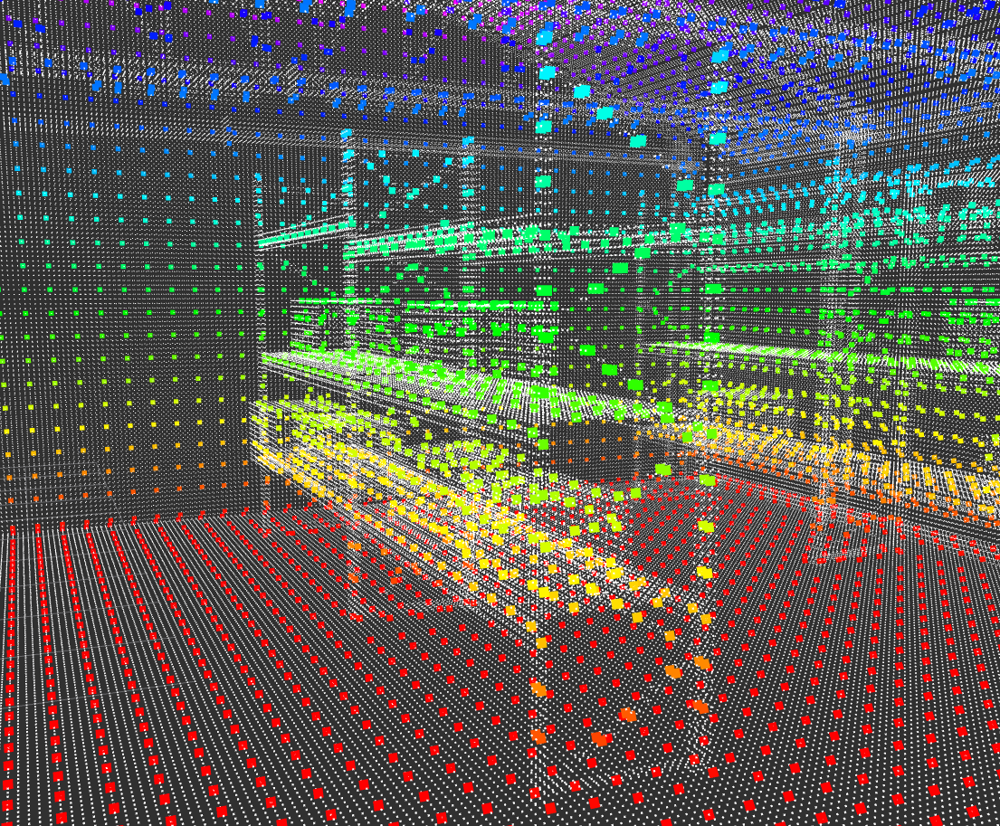
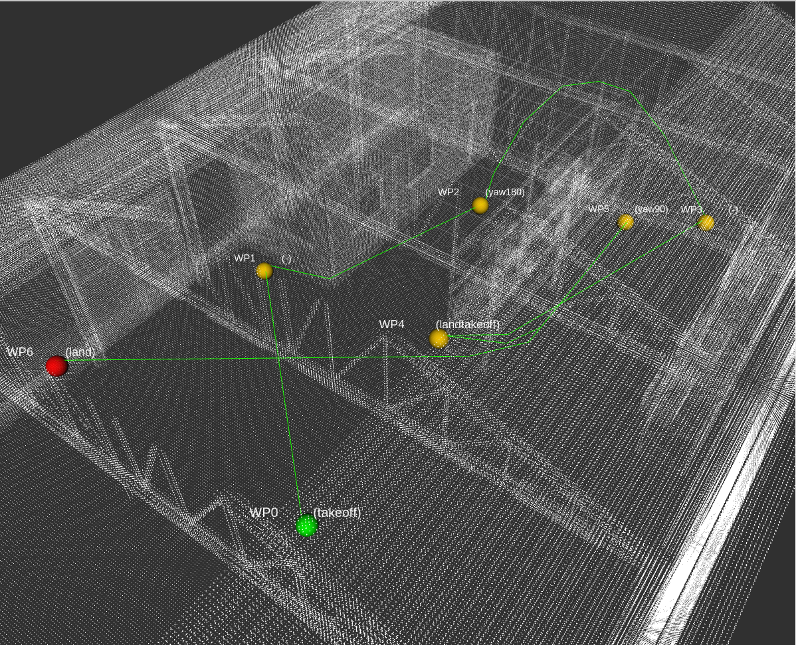

# My Drone Control — Map Processing and Mission Path Planning

A ROS 2 package for 3D PCD map processing, voxel grid downsampling, 3D obstacle inflation, spatial occupancy querying, mission CSV waypoint parsing, 3D A* path planning, and line-of-sight path post-processing for autonomous drone navigation in hangar environments.

## Contents

- [A1.1 — Map processing and path planning](#a1-1-map-processing)
- [A1.2 — Mission execution, indoor flight](#a1-2-mission-execution)
- [A1.3 — Outdoor GPS mission](#a1-3-outdoor-mission)
- [Prerequisites and build](#prerequisites-and-build)
- [How to run](#how-to-run)
- [ROS 2 interface](#ros-2-interface)
- [Mission pipeline](#mission-pipeline)
- [Implementation overview](#implementation-overview)
- [Launch file](#launch-file)

---

<a id="a1-1-map-processing"></a>
## A1.1 — Map processing and path planning

### 1. Map loading (1.5 pts)

* **Map Source**: FEI LRS Point Cloud (`maps/map.pcd`).

* **Loader**: The map is loaded using the Point Cloud Library (PCL)
  through `pcl::io::loadPCDFile`. The raw PCD file is stored as a
  `pcl::PointCloud<pcl::PointXYZ>`.

* **Downsampling Strategy**: The raw point cloud is downsampled using a 3D Voxel Grid filter (`pcl::VoxelGrid`) with a configurable leaf size of **0.25 m by default**.

* **3D Spatial Representation**: Each downsampled point is converted
  into a discrete 3D voxel represented by `Index3D`, containing
  integer `x`, `y`, and `z` indices. Occupied voxels are stored in an
  `unordered_set<Index3D, Index3DHash>`, providing average-case
  $O(1)$ occupancy lookup.


* **Coordinate Conversion**:

  * World coordinates are converted to voxel indices using `pointToIndex()`.
  * Voxel indices are converted back to voxel-center coordinates using `indexToPoint()`.



*Figure 1: Raw FEI LRS point cloud and its 3D voxel-grid representation
visualized together in RViz. The map is represented directly in X, Y
and Z rather than using stacked 2D layers.*

#### Measured Map Metrics

* **World Bounding Box**:
  - $X \in [-0.30, 17.95]$ m
  - $Y \in [-1.15, 13.20]$ m
  - $Z \in [0.00, 5.95]$ m

* **Spatial Resolution**: $0.25\text{ m}$ voxel leaf size.

* **Occupied Voxel Count**: $16482$ Reported from
  `occupied_grid_.size()` after voxelization.

* **Spatial Occupancy Query**: A world-space coordinate is converted
  to an `Index3D` using `pointToIndex()` and checked against the
  occupancy representation. The underlying hash lookup provides
  average-case $O(1)$ complexity.

---

### 2. Obstacle inflation (0.5 pts)

#### Safety Radius

The planner uses a configurable obstacle inflation radius:

```text
safety_radius = 0.60 m
```
The value of $0.60$ m is based on the estimated drone body radius,
position-controller tolerance, and an additional safety margin:

$$ r_{\text{safety}} = r_{\text{drone}} + r_{\text{controller}} + r_{\text{margin}} $$

Using the project values:

$$ 0.33 + 0.15 + 0.12 = 0.60\text{ m} $$

This provides clearance for the physical drone body as well as
position-control error and an additional safety margin.

The implementation converts the physical radius into a number of voxels:

$$
r_{\text{voxels}}
=
\left\lceil
\frac{r_{\text{safety}}}{r_{\text{voxel}}}
\right\rceil
$$

With the default values of $r_{\text{safety}} = 0.60$ m and
$r_{\text{voxel}} = 0.25$ m, the resulting inflation radius is
$3$ voxels.

For every occupied voxel, neighboring voxels are examined in all three
dimensions. A voxel is added to the inflated obstacle representation if:

$$
dx^2 + dy^2 + dz^2
\leq
r_{\text{voxels}}^2
$$

This produces a spherical 3D inflation around each occupied voxel.


*Figure 2: 3D inflated voxel representation visualized in RViz. The
obstacles are expanded in X, Y and Z according to the configured
0.60 m safety radius.*

#### Steel Racks / Shelving Handling

Steel shelving and other obstacles represented by the point cloud are converted
into occupied voxels and then expanded using the 3D spherical inflation process.

The inflation can fill small gaps between nearby occupied voxels, producing a
more conservative obstacle representation. The A* planner then treats the
resulting inflated voxels as occupied.

---

### 3. Advanced planning algorithm — A* (2.0 pts)

* **Algorithm**: 3D A* grid search using a **26-connected neighborhood**. Each voxel can have up to 26 neighboring voxels.

* **Search Space**: The planner operates directly on the inflated voxel grid.

* **Heuristic**: 3D Euclidean distance:

$$
h(n)
=
\sqrt{
\Delta x^2 +
\Delta y^2 +
\Delta z^2
}
$$

The Euclidean heuristic is admissible because it represents the
shortest possible geometric distance between the current voxel and
the goal. Obstacles can only increase the actual path cost, so the
heuristic never overestimates the optimal remaining cost.

* **A* Cost Function**:

$$
f(n) = g(n) + h(n)
$$

where:

* $g(n)$ is the accumulated cost from the start voxel to node $n$.

* $h(n)$ is the Euclidean heuristic estimate from node $n$ to the goal.

* $f(n)$ is the estimated total path cost through node $n$.

* **Movement Cost**:

$$
c(n,n')
=
\sqrt{
\Delta x^2 +
\Delta y^2 +
\Delta z^2
}
$$

This produces:

* Axis-aligned movement: $1$

* 2D diagonal movement: $\sqrt{2}$

* 3D diagonal movement: $\sqrt{3}$

* **Open Set**: A priority queue stores nodes ordered by their lowest $f$ score.

* **Closed Set**: An `unordered_set` stores already expanded voxels.

* **Cost Tracking**: `g_score` stores the best known cost from the start to each voxel.

* **Path Reconstruction**: `came_from` stores the predecessor of each voxel. When the goal is reached, the path is reconstructed backwards and then reversed.

* **Collision Checking**: Neighboring voxels contained in the inflated occupancy grid are rejected.

* **Sequential Waypoint Planning**: The mission CSV is interpreted as an ordered list of waypoints. A separate A* search is performed between every pair of consecutive waypoints.

* **Unreachable Goals**: If the start or goal voxel is occupied, or the A* search cannot reach the goal, an empty path is returned and mission planning stops.

* **Performance Measurement**: The complete mission planning process is timed using `std::chrono::high_resolution_clock` and the elapsed time is reported in milliseconds.

---

### Mission CSV Processing

Mission waypoints are loaded from a CSV file.

Expected format:

```text
x,y,z,precision,task
```

For example:

```text
0.0,0.0,1.0,0.1,takeoff
4.0,2.0,2.0,0.1,inspection
8.0,4.0,2.5,0.1,landing
```

The parser:

* skips empty lines,
* skips lines beginning with `#`,
* skips the header row,
* converts `x`, `y`, and `z` to `double`,
* stores `precision` and `task` as strings,
* ignores malformed numeric rows.

Waypoint coordinates (`x`, `y`, `z`) determine the A* search. The `precision` and `task` fields do not affect route search; the planner preserves them on the corresponding mission waypoint when it publishes the executable mission.

---

### 4. Path post-processing (1.0 pt)

The raw A* path consists of neighboring voxels and may contain many unnecessary intermediate points.

The planner therefore performs a second processing stage using `simplifyPath()`.

* **Line-of-Sight Shortcutting**: The simplifier attempts to connect the current path point directly to the furthest future point that can be reached without intersecting an occupied inflated voxel.

* **3D Segment Checking**: `isLineOfSightFree()` samples positions along the 3D segment between two voxel indices.

* **Voxel Conversion**: The sampled coordinates are rounded to the nearest voxel index.

* **Collision Check**: Every sampled voxel is checked against the inflated occupancy grid.

* **Greedy Simplification**: For every current point, the algorithm searches for the furthest future point with a clear line of sight and adds that point to the simplified path.

This is a sampled 3D line-of-sight check rather than a classical DDA voxel traversal algorithm.

#### Waypoint Reduction Evidence

| Route Test Case          | Mission Source                   | Raw A* Points | Simplified Points | Point Reduction | Execution Time | Safety Check |
| ------------------------ | -------------------------------- | ------------: | ----------------: | --------------: | -------------: | ------------ |
| **Exam Mission 1**       | `exam_example.csv` (7 waypoints) |           172 |                24 |       **86.0%** |    ~2563.44 ms | PASSED       |

The reported execution time measures the complete sequential mission planning process, including the A* searches and path simplification.



*Figure 4: Final post-processed 3D mission path visualized in RViz. The
displayed path is the result of 3D A* planning followed by line-of-sight
shortcutting, and is shown together with the inflated voxel map and
mission waypoints.*

[Back to Contents](#contents)

<a id="a1-2-mission-execution"></a>
## A1.2 — Mission execution, indoor flight

**Mission data.** A CSV row is a goal, not a path point. The planner searches
between rows and publishes the simplified route plus each goal's task metadata.
Rows use `x,y,z,precision,task` in map coordinates, metres; example tasks are
`takeoff`, `yaw180`, `landtakeoff`, and `land`.

### 1. Controller and mission flow (1.5 points)

**Nodes:** `map_planner_node` reads and plans the CSV; `takeoff_drone` receives
`/planned_commands` and controls MAVROS. The mission topic is transient-local,
so the controller can start after the planner.

**Runtime mission selection:** pass a different CSV path without rebuilding:

```bash
ros2 run my_drone_control map_planner_node --ros-args \
  -p mission_path:=/absolute/path/to/mission.csv
```

The controller runs at **10 Hz**. It waits for FCU connection, requests and
observes `GUIDED`, arms, then waits for takeoff altitude on
`/mavros/global_position/rel_alt`. MAVROS responses are checked for mode and
arm requests. `FlightAssistant` republishes the position target at **20 Hz**.


**Manual setup:** follow the LRS-URK README to start the hangar Gazebo world,
ArduPilot SITL, and MAVROS in three terminals. Then start planner and controller
in sourced ROS terminals. Keeping SITL visible helps diagnose pre-arm failures.

### 2. Position and precision (2.0 points)

`FlightAssistant` transforms map positions to local setpoints using
`local_x = -map_y`, `local_y = map_x`, and `local_z = map_z`. It publishes
continuously on `/mavros/setpoint_position/local`.

| Mode | Position radius | Yaw tolerance | Purpose |
| --- | ---: | ---: | --- |
| **soft** | 0.30 m | 10° | Looser transit tolerance. |
| **hard** | 0.15 m | 5° | Closer positioning at task goals. |

The tighter hard radius makes the distinction measurable; the larger soft
radius gives more tolerance during transit. 


### 3. Flight tasks (1.5 points)

| Task | Current behavior | Remaining work |
| --- | --- | --- |
| **`takeoff`** | Uses the first takeoff row's Z (or `target_altitude`) and monitors relative altitude. | Retry and report rejected takeoff requests correctly. |
| **`land`** | Commands local Z to zero; exits when relative altitude is low. | Request LAND mode and verify disarm. |
| **`landtakeoff`** | Descends to zero, then commands the row's Z and waits to climb. | Handle touchdown disarm, re-arm, and re-enter GUIDED. |

Mission altitude is checked using `/mavros/global_position/rel_alt` (above
home), not GPS AMSL. The current land behaviors do not yet meet the complete
safe-landing requirements.

### 4. Yaw and travel heading (1.0 point)

Yaw tasks are parsed from `yaw<degrees>` and added to the assistant's target.
Setpoint yaw uses **ENU**: zero points East; positive angles rotate
counter-clockwise. The controller checks measured pose yaw against the target
before advancing.

[Back to Contents](#contents)

---

<a id="a1-3-outdoor-mission"></a>
## A1.3 — Outdoor mission: GPS, compass, and trajectories

The outdoor node runs the mission relative to the current home position, so
coordinates change with each launch. The sequence is **takeoff → POI-facing
square → figure-8 → return → land**. The sections below follow the six scored
specification points and describe what the code does; SITL and real-sensor
acceptance still need to be demonstrated before hardware use.

| Parameter | Default | Reason |
| --- | ---: | --- |
| `target_altitude` | 5 m | Required height above launch. |
| `square_side` | 5 m | Required square size. |
| `poi_east_offset`, `poi_north_offset` | 2.5 m, -2.5 m | Places the ground POI at the centre of the launch-relative square. |
| `figure_eight_amplitude` | 3 m | Required figure-8 size; produces a 6 m by 3 m track. |
| `figure_eight_omega` | 0.25 rad/s | Limits peak speed to about 1.06 m/s; lap time is about 25.1 s. |
| `square_speed` | 1 m/s | Conservative traversal rate; tune down for noisy or windy conditions. |

### 1. GPS, origin, compass, and altitude (1.5 points)

The node subscribes to the GPS fix, satellite count, home position, compass,
local pose, and relative altitude. It will not proceed to mode/arming until
the GPS fix is valid and fresh, satellite count meets `min_satellites`, an
origin is available, and local pose data has arrived. It prefers MAVROS home;
after `home_timeout`, it falls back to the first usable fix. Mission positions
are offsets from launch, not hardcoded session latitude/longitude.

GPS geodetic coordinates are converted to local ENU metres, and the inverse
conversion reports the POI and square-corner coordinates. The node logs GPS
latitude/longitude/AMSL, GPS-derived ENU from origin, local-pose ENU, and both
compass and pose yaw once per second. Compass heading is magnetic degrees,
clockwise from North; ENU yaw is degrees counter-clockwise from East:

```text
yaw_ENU = wrap(90 degrees - compass_heading)
```

The mission uses **horizontal yaw toward the POI**; it does not command camera
or gimbal pitch. Takeoff altitude is 5 m above launch, requested through the
MAVROS takeoff service and checked using `/mavros/global_position/rel_alt`.
GPS AMSL is reported separately; local pose Z is used for local position
setpoints.

**Coordinate approximation:** conversion uses a local flat-Earth tangent
approximation with the equatorial Earth radius. At 50 m, curvature contributes
less than a millimetre; the radius approximation contributes about 0.2% scale
error (around 0.1 m over 50 m), before GPS error. Compass/pose yaw is logged for
comparison, but agreement while rotating in SITL still needs to be verified.

### 2. Takeoff to 5 m (0.5 points)

After GPS and MAVROS readiness, the node requests `GUIDED`, arms, and requests
takeoff to `target_altitude` (default **5 m**). It advances only when relative
altitude reaches the target within `altitude_tolerance`, then waits
`hover_time` before beginning the square. Thus the transition is altitude-
checked, not based on a fixed takeoff sleep. A stable hover must still be
confirmed in the full SITL run.

### 3. POI tracking around the square (1.5 points)

The four 5 m square corners are generated from the launch position in ENU. The
POI is a parameterized ground offset from launch; defaults `poi_east_offset =
2.5 m` and `poi_north_offset = -2.5 m` place it at the square centre. On every
20 Hz square update, the node computes the horizontal bearing from the
vehicle's current position to the POI and publishes that as yaw while moving
the position setpoint along each edge. Yaw therefore continues changing
between corners instead of snapping only at the corners.

The code logs yaw error at each reached corner. A small error across the whole
edge must be confirmed from a rosbag; that acceptance test has not been
demonstrated here.

### 4. Continuous figure-8 (2.0 points)

After the closed square, the vehicle first transits to the POI. Only once it is
within `position_tolerance` does the 20 Hz trajectory timer start. It computes
one full lap from elapsed time, not from a waypoint list:

$$
x(t)=x_{POI}+A\sin(t),\qquad
y(t)=y_{POI}+A\sin(t)\cos(t),\qquad
t=\omega(now-t_{start})
$$

The defaults preserve the required geometry: **A = 3 m** and
`figure_eight_omega = 0.25 rad/s`. Peak speed is
$A\omega\sqrt{2} \approx 1.06\,m/s$, below the 1.5 m/s limit; one lap takes
$2\pi/\omega \approx 25.1\,s$. The node rejects rates that exceed that speed
limit. Check the POI offset plus the 3 m amplitude against the configured
geofence before flight.

### 5. Tangent heading (1.0 point)

For each figure-8 setpoint, yaw follows the velocity tangent:

$$
\psi(t)=\operatorname{atan2}(\cos(2t),\cos(t))
$$

The node publishes yaw with each local position target and unwraps successive
angles to avoid a full-turn jump at the $-180^\circ/180^\circ$ boundary. The
setpoint mask ignores yaw rate, so heading is commanded as **yaw angle**, not
yaw rate. Smooth heading through a complete lap still needs to be observed in
SITL.

### 6. Return, land, and abort (0.5 points)

After one lap the node returns to the launch position and requests ArduPilot
`LAND` mode. `/outdoor_mission/abort` also requests LAND; if FCU connection,
fresh GPS, local pose, or guided mode is lost during flight, it stops publishing
mission setpoints so it does not fight a safety pilot.

```bash
ros2 service call /outdoor_mission/abort std_srvs/srv/Trigger "{}"
```

**Before any real flight:** demonstrate the complete mission and abort path in
SITL, check the geofence and failsafes, and fly only with the instructor and
safety pilot present.

[Back to Contents](#contents)

---

<a id="prerequisites-and-build"></a>
## 2. Prerequisites & Build Instructions

Ensure that ROS 2, PCL, and the package dependencies are installed.

Build the package with:

```bash
cd /home/user/ros2_ws

colcon build --packages-select my_drone_control

source install/setup.bash
```

[Back to Contents](#contents)

---

<a id="how-to-run"></a>
## 3. How to Run

### One-command startup

Build and source the workspace, then run the unified launch file. It reports
the simulator repository found for each assignment before asking which one to
run. If there is no interactive terminal, it starts assignment `1` when that
repository is available, otherwise assignment `2`.

```bash
cd ~/ros2_ws
source /opt/ros/jazzy/setup.bash
colcon build --packages-select my_drone_control
source install/setup.bash
ros2 launch my_drone_control planner.launch.py
```

Assignment `1` prompts `Open RViz? [y/N]`, then starts `map_planner_node`,
optional RViz, Gazebo, ArduPilot SITL, MAVROS, and finally `takeoff_drone`. It
uses the bundled `maps/map.pcd` and `missions/exam_example.csv`. Set
`LRS_REPO_DIR` if this simulator repository is not at `~/LRS-URK`:

```bash
LRS_REPO_DIR=/path/to/LRS-URK ros2 launch my_drone_control planner.launch.py
```

Assignment `2` starts the outdoor Gazebo world, ArduPilot SITL, MAVROS, and
`outdoor_mission` as managed processes in the launch terminal. Press **Ctrl+C**
there once to stop the full stack. It checks `~/Documents/github/LRS-URK` first,
then `~/LRS-URK`, and selects the first repository containing the required
simulator scripts. See [A1.3](#a1-3-outdoor-mission) for its mission behavior
and parameters. Set `LRS_2_REPO_DIR` to use a different checkout:

```bash
LRS_2_REPO_DIR=/path/to/other/LRS-URK ros2 launch my_drone_control planner.launch.py
```

Assignment `1` uses `LRS_REPO_DIR` (default `~/LRS-URK`); assignment `2` uses
`LRS_2_REPO_DIR` or its search locations above. Both modes are managed by the
launch process and can be stopped with **Ctrl+C** in that terminal. Both start
a flight controller that can arm and execute a mission once MAVROS connects.
Use the SITL simulation and verify the selected mission before running it.

### Manual startup

Use separate terminals to inspect or control processes individually. In each
ROS terminal, first source ROS and the workspace:

```bash
source /opt/ros/jazzy/setup.bash
source ~/ros2_ws/install/setup.bash
```

Start the following processes in order:

1. **Gazebo**, from the LRS-URK repository:
  ```bash
  cd ~/LRS-URK
  ./scripts/run_gazebo.sh
  ```
2. **ArduPilot SITL**, in another terminal:
  ```bash
  cd ~/LRS-URK
  ./scripts/run_sitl.sh
  ```
3. **MAVROS**, in another sourced terminal:
  ```bash
  cd ~/LRS-URK
  ./scripts/run_mavros.sh
  ```
4. **Map planner**, in a sourced ROS terminal:
  ```bash
  ros2 run my_drone_control map_planner_node
  ```
5. **Takeoff and mission controller**, in another sourced ROS terminal:
  ```bash
  ros2 run my_drone_control takeoff_drone
  ```
6. **RViz, optionally**, in another sourced ROS terminal:
  ```bash
  rviz2 -d $(ros2 pkg prefix my_drone_control)/share/my_drone_control/config/planner_view.rviz
  ```

Stop each manual process with Ctrl+C in its terminal. To use another mission
CSV, pass it to the planner:

```bash
ros2 run my_drone_control map_planner_node --ros-args -p mission_path:=/path/to/mission.csv
```

The planner also accepts `map_path`, `voxel_size`, and `safety_radius` overrides.

[Back to Contents](#contents)

---

<a id="ros-2-interface"></a>
## 4. ROS 2 Interface

### Published Topics

All publishers use a QoS profile with depth `1` and `transient_local` durability.

| Topic | Type | Description |
| --- | --- | --- |
| `/map_raw` | `sensor_msgs/msg/PointCloud2` | Original PCD point cloud. |
| `/voxel_grid` | `sensor_msgs/msg/PointCloud2` | Downsampled point cloud produced by the PCL VoxelGrid filter. |
| `/voxel_inflated` | `sensor_msgs/msg/PointCloud2` | Inflated 3D occupancy representation. |
| `/planned_path` | `nav_msgs/msg/Path` | Simplified route for RViz visualization. |
| `/planned_commands` | `my_drone_control/msg/PlannedMission` | Executable route with mission precision and task metadata for `takeoff_drone`. |

All map and route positions use the `map` frame. The mission topic uses
transient-local durability so the takeoff node can receive a mission published
before it starts.

### Parameters

| Parameter       | Type     |                                                             Default | Description                          |
| --------------- | -------- | ------------------------------------------------------------------: | ------------------------------------ |
| `map_path`      | `string` |              `/home/user/ros2_ws/src/my_drone_control/maps/map.pcd` | Path to the PCD map file.            |
| `mission_path`  | `string` | `/home/user/ros2_ws/src/my_drone_control/missions/exam_example.csv` | Path to the mission CSV file.        |
| `voxel_size`    | `double` |                                                              `0.25` | Voxel-grid resolution in meters.     |
| `safety_radius` | `double` |                                                              `0.60` | Obstacle inflation radius in meters. |

> **Note:** The default paths are absolute paths from the development workspace and may need to be changed when the package is used in another workspace or on another computer.

[Back to Contents](#contents)

---

<a id="mission-pipeline"></a>
## 5. Mission Pipeline

```text
PCD map -> voxel grid -> inflated occupancy map
          |
Mission CSV -> sequential A* -> simplified route
          |
         +------------+-------------+
         |                          |
         v                          v
   /planned_path (Path)       /planned_commands
     RViz                 (PlannedMission)
                |
                v
            takeoff_drone
```

[Back to Contents](#contents)

---

<a id="implementation-overview"></a>
## 6. Implementation Overview

The planner loads the PCD and mission CSV, builds an inflated voxel map, runs
3D A* between consecutive mission waypoints, and simplifies each route segment.
It publishes the route for visualization on `/planned_path` and the executable
mission, including waypoint task metadata, on `/planned_commands`.

[Back to Contents](#contents)

---

<a id="launch-file"></a>
## 7. Launch File

`launch/planner.launch.py` discovers and reports both simulator repository
paths before asking which assignment to run. Assignment `1` starts the planner
and its simulator stack, with optional RViz; assignment `2` starts its outdoor
world, simulator, and mission node as managed launch processes. See
[How to Run](#how-to-run) for the distinct repository path settings. Use the
manual startup instructions when you want processes individually managed in
separate terminals.

[Back to Contents](#contents)
