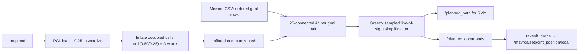
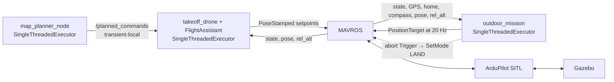

# My Drone Control — Map Processing and Mission Path Planning

A ROS 2 package for 3D PCD map processing, voxel grid downsampling, 3D obstacle inflation, spatial occupancy querying, mission CSV waypoint parsing, 3D A* path planning, and line-of-sight path post-processing for autonomous drone navigation in hangar environments.

## Contents

- [A1.1 — Map processing and path planning](#a1-1-map-processing)
- [A1.2 — Mission execution, indoor flight](#a1-2-mission-execution)
- [A1.3 — Outdoor GPS mission](#a1-3-outdoor-mission)
- [Prerequisites and build](#prerequisites-and-build)
- [How to run](#how-to-run)
- [ROS 2 interface](#ros-2-interface)
- [Solution diagrams](#solution-diagrams)

---

<a id="a1-1-map-processing"></a>
## A1.1 — Map processing and path planning

### 1. Map representation

PCL loads `maps/map.pcd` and downsamples it into a **0.25 m uniform voxel grid**. Occupied cells are stored in a hash set for constant-average-time collision queries. This resolution preserves hangar-scale features and keeps neighbour checks simple. An octree could save memory in empty regions, but adds variable-resolution query complexity; the uniform grid uses more memory and loses features smaller than one cell. The filtered map contains 16,482 occupied voxels.

### 2. Obstacle inflation

The configured `safety_radius` is **0.60 m**, estimated from 0.33 m vehicle radius, 0.15 m controller error, and 0.12 m margin. The implementation rounds `ceil(0.60 / 0.25)` up to **3 voxels**, then inflates cells satisfying `dx² + dy² + dz² <= 3²`. Thus the effective radius between voxel centres is **0.75 m**. This errs on the side of clearance but may close narrow gaps. Shelves are blocked only where they appear in the PCD; sparse map points can leave false-clear areas.

### 3. 3D A* planning

The planner uses 26-connected A* on the inflated grid, with Euclidean edge costs and an admissible Euclidean heuristic. If the search completes, it gives a lowest-cost path on the discrete voxel graph. Compared with RRT, it is deterministic and directly uses the occupancy grid; its costs are memory/runtime growth with explored cells and no continuous-space optimality. Diagonal transitions check the destination voxel only, so corner-cutting near obstacles is a known limitation.

The CSV (`x,y,z,precision,task`) contains ordered goal waypoints, not a path. A separate search connects each consecutive pair. Occupied endpoints or an exhausted search stop planning.

### 4. Path simplification

Greedy line-of-sight shortcutting replaces a path section with the furthest later voxel visible through the inflated grid. The example reduced **172 points to 24 (86%)** in about **2.56 s** on this machine. Segments are checked using rounded samples, which is fast but not exact voxel traversal; a collision between samples can be missed, so this is not a formal continuous collision guarantee.


[Back to Contents](#contents)

---

<a id="a1-2-mission-execution"></a>
## A1.2 — Mission execution, indoor flight

The planner publishes `/planned_commands`; `takeoff_drone` controls MAVROS. A mission file can be selected at runtime with `-p mission_path:=/path/to/file.csv`. The controller runs at 10 Hz and `FlightAssistant` sends position setpoints at 20 Hz.

### Position and precision

Map positions are converted to local targets using `local_x = -map_y`, `local_y = map_x`, `local_z = map_z`.

| Precision | Position radius | Yaw tolerance |
| --- | ---: | ---: |
| `soft` | 0.30 m | 10° |
| `hard` | 0.15 m | 5° |

The tighter hard radius is intended for accurate task goals; the looser soft radius allows more transit tolerance. **Known limits:** arrival is a single position/yaw sample, without a settling period or velocity check. Intermediate planned points are also processed in order and can inherit hard precision, so they may cause stops instead of passing through.

### Tasks and heading

`takeoff` uses the first takeoff row's Z (or the `target_altitude` parameter) and monitors relative altitude. `land` lowers the local Z target and exits near ground level; it does not request LAND mode or confirm disarming. `landtakeoff` descends and climbs again but does not re-arm or restore GUIDED after touchdown.

Yaw setpoints use ROS ENU: zero is East and positive is counter-clockwise. `yaw<degrees>` adds to an internal target that starts at zero, rather than the measured aircraft heading. The controller does not calculate the next segment bearing or unwrap to the shortest turn, so forward-facing travel and reliable absolute/relative yaw tasks remain incomplete. MAVROS converts ENU targets to the FCU's NED convention.

[Back to Contents](#contents)

---

<a id="a1-3-outdoor-mission"></a>
## A1.3 — Outdoor GPS mission

The outdoor mission is relative to the captured home/origin: **takeoff → square → POI transit → figure-8 → return → land**. Parameters keep the required 5 m altitude, 5 m square, and 3 m amplitude. The default `figure_eight_omega = 0.25 rad/s` gives peak speed `Aω√2 ≈ 1.06 m/s` and lap time `2π/ω ≈ 25.1 s`.

### GPS, coordinates, compass, and altitude

The node waits for a fresh valid GPS fix and at least six satellites before requesting mode or arming. It prefers MAVROS home, falling back to the first usable fix after five seconds. Planning offsets are local ENU, not fixed absolute coordinates. Geodetic-to-ENU and inverse conversions use a flat-Earth tangent approximation with the equatorial radius. Over 50 m, curvature contributes under 1 mm; the radius approximation contributes about 0.2% scale error (about 0.1 m), before GPS error.

GPS altitude is AMSL; `/mavros/global_position/rel_alt` is above home; setpoint Z is local ENU up. The mission requests 5 m takeoff and checks relative altitude. Compass is magnetic degrees clockwise from North; pose/setpoint yaw is ENU degrees counter-clockwise from East, with `yaw_ENU = wrap(90° - heading)`. The node logs both conventions for comparison; empirical agreement while rotating in SITL still needs validation. Yaw aims horizontally at the POI; no camera pitch is commanded.

### Square, trajectory, and return

At 20 Hz, the node recomputes bearing to the parameterized POI while following the four 5 m square edges. It then transits to the POI before starting the timer-driven figure-8:

$$x=x_{POI}+A\sin(t),\quad y=y_{POI}+A\sin(t)\cos(t),\quad t=\omega(now-t_{start})$$

For default offsets (2.5 m East, -2.5 m North), the square’s far corner is 7.07 m from launch; the farthest figure-8 point is about 6.37 m from launch. The square therefore sets the 7.07 m horizontal bound. Add launch-to-home offset when checking the home-centred geofence; the node does not enforce a geofence. Tangent yaw is commanded with each setpoint and unwrapped between updates. Smooth tracking and completion have not yet been evidenced by a full SITL run.

After one lap it returns to launch and requests LAND. `/outdoor_mission/abort` also requests LAND. If FCU/GPS/pose freshness or GUIDED mode is lost in flight, it stops publishing mission setpoints. Demonstrate abort and full mission in SITL before any real flight; an instructor and safety pilot are required.

```bash
ros2 service call /outdoor_mission/abort std_srvs/srv/Trigger "{}"
```

[Back to Contents](#contents)

---

<a id="prerequisites-and-build"></a>
## 2. Prerequisites & Build Instructions

Ensure that ROS 2, PCL, and the package dependencies are installed.

Build the package with:

```bash
cd /home/user/ros2_ws

colcon build --packages-select my_drone_control

source install/setup.bash
```

[Back to Contents](#contents)

---

<a id="how-to-run"></a>
## 3. How to Run

### One-command startup

Build and source the workspace, then run this command to start either complete
simulation stack:

```bash
cd ~/ros2_ws
source /opt/ros/jazzy/setup.bash
colcon build --packages-select my_drone_control
source install/setup.bash
ros2 launch my_drone_control planner.launch.py
```

**Startup pipeline**

1. **Find simulator checkouts.** The launch searches for the repositories and
  prints the paths it found. Override the defaults with `LRS_REPO_DIR` and
  `LRS_2_REPO_DIR`.
2. **Choose an assignment.** Select `1` for indoor or `2` for outdoor. For
  assignment `1`, answer whether to open RViz.
3. **Start the mission node.** Assignment `1` starts `map_planner_node` with
  the bundled map and `missions/exam_example.csv`. Assignment `2` starts
  `outdoor_mission`, which waits for GPS readiness before requesting flight
  mode or arming.
4. **Start Gazebo.** Assignment `1` uses the hangar world; assignment `2` uses
  the outdoor world. Optional RViz starts alongside the indoor planner.
5. **Start ArduPilot SITL.** It starts 5 seconds after Gazebo.
6. **Start MAVROS.** It starts 5 seconds after SITL.
7. **Begin control.** For assignment `1`, `takeoff_drone` starts 10
  seconds after MAVROS. Assignment `2` is already running and proceeds when
  its GPS and MAVROS readiness checks pass.

All processes are managed by the launch. Press **Ctrl+C once in the launch
terminal** to stop the stack. See [A1.3](#a1-3-outdoor-mission) for the outdoor
mission details.

### Manual startup

Use separate terminals to inspect or control processes individually. The
commands use `~/LRS-URK`; change that directory to the location of your LRS-URK
repository if it is elsewhere. In each ROS terminal, source ROS and the
workspace:

```bash
source /opt/ros/jazzy/setup.bash
source ~/ros2_ws/install/setup.bash
```

#### Assignment 1: indoor mission

Start the following processes in order:

1. **Gazebo**, from the LRS-URK repository:
  ```bash
  cd ~/LRS-URK
  ./scripts/run_gazebo.sh
  ```
2. **ArduPilot SITL**, in another terminal:
  ```bash
  cd ~/LRS-URK
  ./scripts/run_sitl.sh
  ```
3. **MAVROS**, in another sourced terminal:
  ```bash
  cd ~/LRS-URK
  ./scripts/run_mavros.sh
  ```
4. **Map planner**, in a sourced ROS terminal:
  ```bash
  ros2 run my_drone_control map_planner_node
  ```
5. **Takeoff and mission controller**, in another sourced ROS terminal:
  ```bash
  ros2 run my_drone_control takeoff_drone
  ```
6. **RViz, optionally**, in another sourced ROS terminal:
  ```bash
  rviz2 -d $(ros2 pkg prefix my_drone_control)/share/my_drone_control/config/planner_view.rviz
  ```

For a different mission CSV, pass its path to `map_planner_node`:

```bash
ros2 run my_drone_control map_planner_node --ros-args -p mission_path:=/path/to/mission.csv
```

The planner also accepts `map_path`, `voxel_size`, and `safety_radius` overrides.

#### Assignment 2: outdoor mission

Open four terminals. In each ROS terminal, source ROS and the workspace as
shown above. Use the same LRS-URK checkout in the first three terminals.

1. **Outdoor Gazebo world:**
  ```bash
  cd ~/LRS-URK
  ./scripts/run_gazebo.sh fei_lrs_outdoor.world
  ```
2. **ArduPilot SITL:** use the home coordinates matching the outdoor world's
  spherical coordinates:
  ```bash
  cd ~/LRS-URK
  HOME_LOCATION="${HOME_LOCATION:-48.15144444,17.07375000,150,0}" \
    ./scripts/run_sitl.sh
  ```
3. **MAVROS:** in another sourced terminal:
  ```bash
  cd ~/LRS-URK
  ./scripts/run_mavros.sh
  ```
4. **Outdoor mission node:** in the fourth sourced terminal:
  ```bash
  ros2 run my_drone_control outdoor_mission
  ```

Start the mission node after MAVROS is publishing data. It waits for a fresh
usable GPS fix and the configured satellite count before requesting flight
mode or arming. Stop each manually started process with **Ctrl+C in its own
terminal**. During flight, the abort service requests LAND:

```bash
ros2 service call /outdoor_mission/abort std_srvs/srv/Trigger "{}"
```

Read [A1.3](#a1-3-outdoor-mission) and follow the safety checklist before
running this mission, especially before any real-drone flight.

[Back to Contents](#contents)

---

<a id="ros-2-interface"></a>
## 4. ROS 2 Interface

### Topics

| Data | Topic | Type |
| --- | --- | --- |
| Planner outputs | `/map_raw`, `/voxel_grid`, `/voxel_inflated` | `sensor_msgs/msg/PointCloud2` |
| Planned route | `/planned_path` | `nav_msgs/msg/Path` |
| Executable mission | `/planned_commands` | `my_drone_control/msg/PlannedMission` |
| Waypoint display | `/mission_markers` | `visualization_msgs/msg/MarkerArray` |
| Indoor position target | `/mavros/setpoint_position/local` | `geometry_msgs/msg/PoseStamped` |
| Outdoor position/yaw target | `/mavros/setpoint_raw/local` | `mavros_msgs/msg/PositionTarget` |
| MAVROS feedback | `/mavros/state`, `/mavros/local_position/pose`, `/mavros/global_position/*` | `mavros_msgs`, `geometry_msgs`, `sensor_msgs`, `std_msgs` |

Planner outputs and `/planned_commands` use depth-1 transient-local QoS. MAVROS
sensor inputs use `SensorDataQoS`; state uses depth 10. The planner and indoor
controller use the `map` frame; the outdoor controller computes ENU targets and
MAVROS converts them for the FCU.

### Services

- MAVROS clients: `/mavros/set_mode`, `/mavros/cmd/arming`, `/mavros/cmd/takeoff`.
- Outdoor abort server: `/outdoor_mission/abort` (`std_srvs/srv/Trigger`); it requests LAND.

```bash
ros2 service call /outdoor_mission/abort std_srvs/srv/Trigger "{}"
```

### Messages and parameters

`PlannedCommand` contains `float64 x, y, z`, `string precision`, and `string task`;
`PlannedMission` contains `PlannedCommand[] commands`. Planner parameters are
`map_path`, `mission_path`, `voxel_size` (0.25 m), and `safety_radius` (0.60 m).

The indoor controller exposes `report_only`, `target_altitude`, `flight_mode`,
`altitude_tolerance`, `connection_timeout`, and `takeoff_timeout`. The last two
are currently declared but not enforced by the control loop. Outdoor mission
parameters, with defaults, are `target_altitude=5.0`, `altitude_tolerance=0.3`,
`min_satellites=6`, `flight_mode=GUIDED`, `home_timeout=5.0`, `hover_time=2.0`,
`square_side=5.0`, `square_speed=1.0`, `poi_east_offset=2.5`,
`poi_north_offset=-2.5`, `figure_eight_amplitude=3.0`,
`figure_eight_omega=0.25`, `position_tolerance=0.3`, `yaw_tolerance=5.0`, and
`landing_tolerance=0.3` (SI units except angles in degrees and rate in rad/s).
Set parameters with `--ros-args -p name:=value`.

All nodes currently use the default single-threaded `rclcpp::spin`; there are
no custom callback groups or ROS Actions. Timer rates: indoor control 10 Hz,
indoor setpoints 20 Hz, outdoor control 10 Hz, outdoor setpoints 20 Hz, and
outdoor reporting 1 Hz.

Launch environment variables: `LRS_REPO_DIR` selects the indoor simulator
checkout; `LRS_2_REPO_DIR` selects the outdoor checkout; `HOME_LOCATION` sets
the outdoor SITL origin to match the world. The planner's default map and CSV
paths are workspace-specific.

[Back to Contents](#contents)

---

<a id="solution-diagrams"></a>
## 5. Solution Diagrams

### Data path



### ROS control



The demo publisher can replace `map_planner_node` as the `/planned_commands`
source for controller testing. No dedicated executor threads or callback
 groups are configured.

Editable Draw.io source: [docs/LRS.drawio](docs/LRS.drawio).

[Back to Contents](#contents)

---
